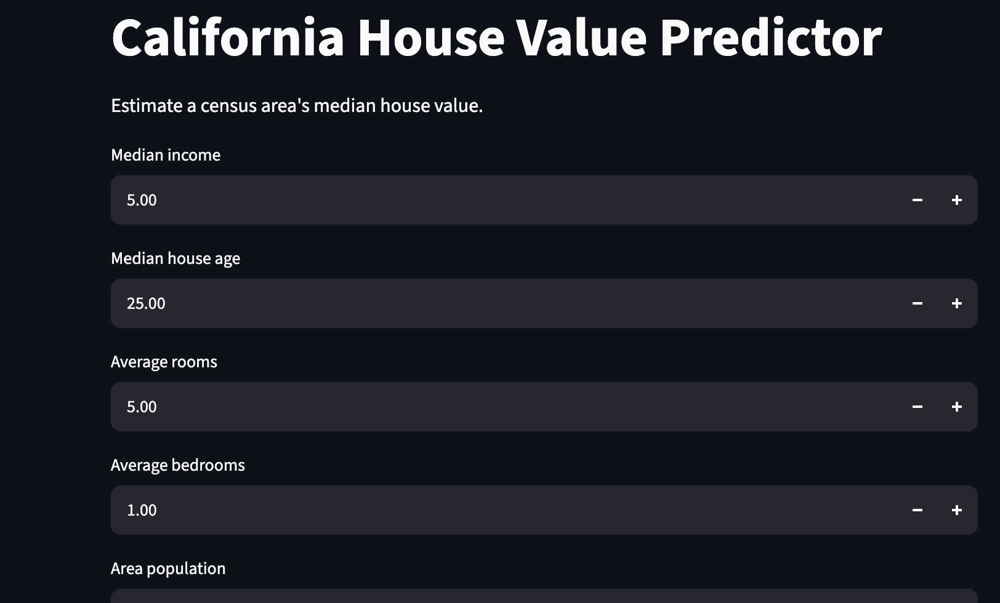

# California House Value Prediction

A machine learning project that predicts median house values for California census areas using housing and demographic features.

## Project Overview
## Application Screenshot

This project explores housing data, trains regression models, compares their performance, and provides an interactive prediction interface built with Streamlit.

**Important:** The dataset comes from the 1990 U.S. Census and represents census areas rather than individual properties. It is intended for educational use, not current property valuation.

## Features

- Data exploration with pandas
- Visual analysis using Matplotlib
- Train/test splitting for model evaluation
- Linear Regression and Random Forest comparison
- Feature importance visualization
- Saved model for reuse
- Interactive Streamlit web app

## Models and Results

Results from the current 80/20 train/test split:

| Model | MAE | R² Score |
|---|---:|---:|
| Linear Regression | 0.533 | 0.576 |
| Random Forest | 0.328 | 0.804 |

The target is measured in units of $100,000. The Random Forest model achieved lower test-set error on this split.

## Technologies

- Python
- pandas and NumPy
- scikit-learn
- Matplotlib
- Streamlit
- joblib

## Run Locally

1. Clone or download this repository.
2. Create and activate a virtual environment.
3. Install dependencies:

   `python -m pip install -r requirements.txt`

4. Run the Streamlit application:

   `python -m streamlit run app.py`

## Dataset

California Housing dataset provided through scikit-learn. The target, `MedHouseVal`, represents median house value in units of $100,000.

## Future Improvements

- Add cross-validation and hyperparameter tuning
- Compare additional regression models
- Improve model interpretation
- Deploy the application online

## Disclaimer

Predictions are educational estimates based on historical data. They should not be used for financial decisions or current real estate valuations.
## Model Performance

The Random Forest regression model was evaluated using a
held-out test set.

- **Mean Absolute Error (MAE):** 0.349
- **R² Score:** 0.790

The model uses historical California housing data to estimate
median house values for census areas. These estimates are
educational and should not be treated as current property valuations.

## Key Features

- Interactive predictions using Streamlit
- Random Forest regression
- Feature-importance visualization
- Model performance metrics
- Data analysis using Python and pandas

## Tech Stack

Python, pandas, scikit-learn, Streamlit, Matplotlib, Git, and GitHub.

## Live Demo

[Try the House Value Predictor](https://house-price-prediction-p5ae6gopjniztljpkr3rvn.streamlit.app/)

## GitHub Repository

[View Source Code](https://github.com/as6374832-prog/House-Price-Prediction)

## Disclaimer

Predictions are educational estimates based on historical data. They should not be used for financial decisions or current real estate valuations.

